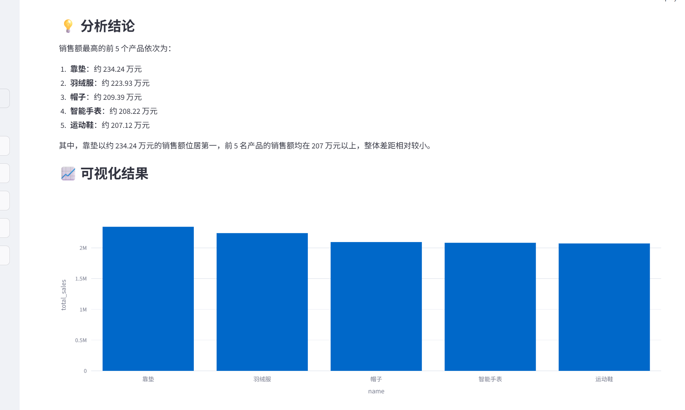
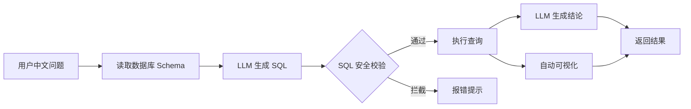

# 自然语言数据分析 Agent

> 用中文直接"问"数据库：自动生成 SQL、执行查询、返回结论并可视化。

基于 **大语言模型 + LangChain** 的 Text-to-SQL 数据分析助手。输入一句中文问题，Agent 自动完成
「自然语言 → SQL → 查询 → 结论 + 图表」的全流程，无需手写任何 SQL。



## ✨ 功能

- 🗣️ **自然语言查询**：用中文提问，自动转换成 SQLite 查询语句
- 🔍 **自动执行**：生成 SQL 后自动查询数据库并返回结果
- 💬 **智能总结**：由大模型把查询结果总结成简洁的中文结论
- 📊 **自动可视化**：根据结果结构自动选择柱状图 / 折线图 / 指标卡 / 表格
- 🛡️ **安全校验**：只允许只读查询，拦截 `DELETE / DROP` 等危险语句

## 🏗️ 架构



## 🧰 技术栈

| 类别 | 技术 |
|------|------|
| 语言 | Python |
| 大模型框架 | LangChain |
| 大模型 API | DeepSeek / OpenAI 兼容接口 |
| 数据库 | SQLite |
| 前端 | Streamlit |
| 可视化 | Plotly、Pandas |

## 🚀 快速开始

```bash
# 1. 克隆项目
git clone https://github.com/zhangjiajiayue/nl2sql-agent.git
cd nl2sql-agent

# 2. 安装依赖
pip install -r requirements.txt

# 3. 配置 API Key
cp .env.example .env
# 编辑 .env，填入你的 API Key

# 4. 生成示例数据库
python data/init_db.py

# 5. 启动
streamlit run app.py
```

然后在浏览器打开 http://localhost:8501

## 💡 使用示例

| 你的问题 | Agent 生成 | 结果 |
|---------|-----------|------|
| 销售额最高的前 5 个产品是什么？ | `SELECT ... ORDER BY total_sales DESC LIMIT 5` | 柱状图 |
| 2024 年每个月的订单总金额趋势 | `SELECT strftime('%Y-%m', order_date) ...` | 折线图 |
| 各城市的客户数量分布 | `SELECT city, COUNT(*) ... GROUP BY city` | 柱状图 |

## 📁 项目结构

```
nl2sql-agent/
├── app.py                  # Streamlit 界面
├── agent/
│   ├── chain.py            # 核心链路：NL → SQL → 查询 → 结论
│   ├── prompts.py          # Prompt 模板
│   └── sql_executor.py     # SQL 清洗 / 安全校验 / 执行
├── utils/
│   ├── config.py           # 配置读取
│   └── viz.py              # 自动图表
├── data/
│   └── init_db.py          # 生成示例数据库
└── requirements.txt
```

## 📌 说明

- 本项目使用 SQLite 内置示例数据库，可替换为你自己的数据库。
- 兼容所有 OpenAI 格式接口（DeepSeek、通义千问、智谱等），只需修改 `.env`。

## 📄 License

MIT